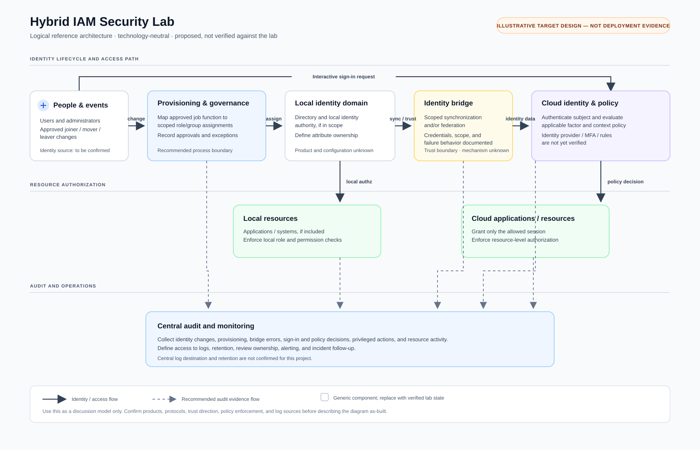

# Hybrid IAM Security Lab — Microsoft Entra Conditional Access

> [!important] Scope and evidence
> This revision uses the Obsidian project note, its linked group and legacy-authentication notes, and the embedded screenshots. The screenshots show Security Defaults disabled, an MFA Conditional Access policy created in Report-only, an emergency-access exclusion group, and a legacy-auth policy still in its creation form without a block grant control. The material does **not** show an enforced replacement baseline, sign-in test results, or the on-premises/hybrid identity connection implied by the project title.

## 1. Executive Summary

The **Hybrid IAM Security Lab** demonstrates Microsoft Entra ID administration and Conditional Access configuration. The available notes and screenshots substantiate an emergency-access account procedure, a security group named `CA-Exclude-EmergencyAccess`, a created MFA policy named `CA-01-Require-MFA-Admins`, and a draft policy intended to block legacy authentication.

The strongest confirmed control outcome is configuration work, not enforced protection: the MFA policy is explicitly **Report-only**, and the legacy-authentication policy screenshot is a draft with **zero grant controls selected** and the Create button still present. A separate screenshot shows Security Defaults **Disabled**. The evidence therefore does not establish that users are currently required to perform MFA or that legacy authentication is blocked.

The screenshots also show a scope mismatch that needs resolution: the MFA policy name says “Admins,” while the captured assignment summary says all users are included. The note text says to select administrative directory roles. Verify the saved policy scope before enabling it.

The project name contains “Hybrid,” but the reviewed notes do not show on-premises Active Directory, Microsoft Entra Connect/Cloud Sync, federation, or another hybrid identity bridge. The architecture below describes the evidenced Entra policy setup and marks that integration as unverified.

## 2. Project Background

### Lab context

The Obsidian note documents a Microsoft Entra tenant and Conditional Access work. The screenshots contain a tenant display name and administrator/contact identifiers; those values are intentionally omitted from this public case study. The note does not say whether the tenant is a disposable lab or a live organization, so this document does not make that assumption.

### Security objectives reflected in the notes

- Preserve emergency administrative access if normal administrator sign-in is unavailable.
- Use a controlled group to identify emergency accounts for Conditional Access exclusions.
- Require MFA through a Conditional Access policy.
- Block legacy authentication clients that cannot satisfy modern authentication requirements.
- Avoid lockout by starting policies in Report-only and reviewing their impact before enforcement.

The first three have some configuration evidence; the MFA policy is not enforced. Legacy-authentication blocking remains a draft in the available capture. No end-to-end sign-in validation was supplied.

### Requirements and current evidence

| Requirement | Evidence-based status |
|---|---|
| Emergency access accounts can recover tenant administration. | The note describes two cloud-only accounts; one screenshot shows one account with an active, direct, permanent Global Administrator assignment. The second account, cloud-only status, authentication methods, and successful sign-in tests are not evidenced. |
| Emergency identities are separately managed for policy exclusions. | A Security group using Assigned membership was created. The creation screen showed two members selected; the final roster was not displayed. |
| MFA policy covers the intended population and resources. | A policy was created in Report-only; a setup screenshot shows all resources and an MFA grant. Captured user scope appears to include all users, despite the “Admins” name and note instructions. Verify the saved assignment. |
| Legacy authentication is blocked. | Not evidenced. A new policy draft selected legacy client types but showed zero grant controls and no creation confirmation. |
| The tenant has a secure baseline while moving from Security Defaults. | Security Defaults are Disabled. The reviewed screenshots do not show equivalent Conditional Access controls in an enforced state. |
| Hybrid directory integration is configured. | Not evidenced in the reviewed notes or captures. |

## 3. Solution Overview

### Confirmed technologies and objects

- **Microsoft Entra ID** — admin-center pages and Entra directory objects are visible in the screenshots.
- **Conditional Access** — an MFA policy was created and another policy was being configured.
- **Security Defaults** — the captured tenant setting is Disabled.
- **Emergency-access group** — `CA-Exclude-EmergencyAccess`, Security type, Assigned membership.
- **Emergency administrator role** — one captured emergency account has a direct, active, permanent Global Administrator role assignment.

No license details, on-premises directory, synchronization service, federation protocol, authentication-method registration, or monitoring destination were provided.

### Lifecycle and access model

The notes do not describe joiner/mover/leaver automation. The verified scope is emergency administrator setup and Conditional Access policy design. Treat lifecycle automation, RBAC beyond the emergency Global Administrator assignment, device-based policy, and centralized logging as unknown unless additional artifacts are added.

## 4. Architecture Design

Editable source: [architecture.mmd](architecture.mmd).

### Components and data flow

1. An administrator or user signs in to Microsoft Entra ID.
2. The created MFA policy is evaluated in Report-only for the population and resources in its saved configuration. Report-only evaluation does not prompt users for MFA or enforce grant controls; outcomes can be reviewed in sign-in logs.
3. The emergency-access group is intended to provide a controlled exclusion for policies that block or restrict sign-in. Microsoft notes that a Report-only policy does not require this exclusion.
4. The legacy-auth policy draft selected Exchange ActiveSync clients and Other clients, but the screenshot shows no Block access grant and no creation confirmation.
5. Security Defaults are disabled. The reviewed material does not show equivalent policies in an enforced state.
6. No local directory or hybrid connector appears in the reviewed evidence. Add that path only after documenting the actual service, direction, and trust configuration.

### Trust boundaries and limitations

- Emergency-access credentials and methods must be controlled separately from ordinary administrator identities.
- Exclusions are high-impact policy exceptions; restrict membership changes and monitor their use.
- Report-only is an evaluation state, not an enforcement state.
- The tenant screenshots include identifiers. Original captures stay in the private vault; redact them before any external sharing.

## 5. Implementation Walkthrough

This walkthrough separates recorded actions from unverified or incomplete steps.

### 5.1 Emergency access accounts

The note instructs creating two accounts in the tenant’s `onmicrosoft.com` domain, assigning Global Administrator, using a strong authentication method, storing recovery material securely, and validating sign-in. The screenshot confirms one account has a direct, active, permanent Global Administrator assignment. It does not show the second account, the full UPN/domain, authentication-method registration, credential storage, or a successful validation sign-in.

Microsoft’s current guidance calls for two or more cloud-only emergency accounts, a phishing-resistant method such as FIDO2 passkeys or certificate-based authentication, permanent active Global Administrator assignment, sign-in monitoring, and regular validation. Confirm which of these were completed in the lab before claiming them.

### 5.2 Security Defaults

The screenshot shows **Security Defaults: Disabled**. The note records disabling defaults while moving to custom Conditional Access. Microsoft advises enabling replacement Conditional Access policies immediately after disabling defaults. The reviewed evidence shows the MFA policy is Report-only and the legacy-auth policy is only a draft, so an equivalent enforced baseline is not demonstrated here. Verify the full tenant policy list and license before deciding whether to restore Security Defaults or complete a Conditional Access rollout.

### 5.3 Emergency exclusion group

The note creates `CA-Exclude-EmergencyAccess` as a Security group with Assigned membership. The creation form showed two members selected and the group list later showed the group exists. The final member list was not opened in the capture, so confirm the two members and ensure no other identities are included.

### 5.4 CA-01 — Require MFA

The screenshots show a policy named `CA-01-Require-MFA-Admins` created successfully and listed in **Report-only**. The configuration capture shows All resources and a Require multifactor authentication grant. A user-assignment screen shows all users included with exclusions, while the written steps call for selecting administrative directory roles. The final saved inclusion/exclusion list should be inspected and reconciled with the policy name and intended scope.

Report-only policies evaluate applicable sign-ins but do not enforce the MFA grant or prompt users. Review the Report-only results in sign-in logs, verify the policy applies to intended accounts, then stage and enable only after testing.

### 5.5 CA-02 — Block legacy authentication

The Obsidian note previously described this as implemented. The available screenshot shows a **New Conditional Access policy** form named `CA-02 — Block Legacy Authentication`. Exchange ActiveSync clients and Other clients are selected, policy state is Report-only, Grant shows zero controls selected, and the Create button remains visible. This is evidence of a draft, not a created or enforcing block policy.

To complete the design, configure Block access as the grant control, review the target and emergency-access exclusions, create in Report-only, inspect interactive and non-interactive legacy sign-in logs, and enable after impact review. Follow Microsoft’s current deployment guidance.

## 6. Screenshot Walkthrough

The source screenshots remain embedded in the private Obsidian note. They are not copied into this public repository because they show tenant IDs, account/contact details, or directory object identifiers.

| Source capture | What it supports | Caption and limit |
|---|---|---|
| `Pasted image 20261026222003.png` | One emergency-access account has a direct, active, permanent Global Administrator assignment. | **Figure 1 — Emergency administrator role assignment.** This proves the visible role assignment only; it does not prove two accounts, authentication-method setup, or a successful emergency sign-in. |
| `Pasted image 20261026222531.png` | Security Defaults displayed as Disabled. | **Figure 2 — Security Defaults state.** This is a captured tenant state; no complete replacement baseline is visible in the reviewed material. |
| `Pasted image 20261026223419.png` | New group named `CA-Exclude-EmergencyAccess`, type Security, membership Assigned, two members selected. | **Figure 3 — Emergency exclusion group setup.** Selection during creation is visible; verify the final saved roster. |
| `Pasted image 20261026223437.png` | The group appears in the group list as Security / Assigned. | **Figure 4 — Emergency exclusion group created.** The object identifier is intentionally omitted; the capture does not expand group members. |
| `Pasted image 20261026224533.png` and `Pasted image 20261026224710.png` | CA-01 setup, all-resources target, MFA grant, Report-only state, and current-user lockout warning. | **Figure 5 — MFA policy configuration.** The “Admins” name conflicts with the all-users inclusion shown in the captured assignment. Confirm the final saved scope and exclusions. |
| `Pasted image 20261026224742.png` | Creation confirmation and policy list showing CA-01 in Report-only. | **Figure 6 — MFA policy created in Report-only.** A created policy is not proof of enforcement or successful sign-in behavior. |
| `Pasted image 20261026230829.png` | CA-02 draft selects Exchange ActiveSync and Other clients; Report-only; zero grant controls; Create still available. | **Figure 7 — Legacy-authentication policy draft.** The screenshot does not show Block access or policy creation. |

## 7. Security Analysis

| Area | Finding from the notes/screenshots | Risk / next action |
|---|---|---|
| Least privilege / RBAC | One emergency account has permanent Global Administrator, an expected emergency-account pattern; ordinary admin roles are not documented. | Keep the privileged assignment limited to dedicated emergency accounts. Confirm the second account and ordinary administrator role model. |
| Emergency access | Two accounts are the intended design; evidence shows one role assignment and a group creation form with two members selected. Authentication methods and recovery testing are not evidenced. | Verify two cloud-only accounts, phishing-resistant methods with dependencies understood, secure storage, monitoring, and periodic tests. |
| MFA | CA-01 has an MFA grant but is Report-only. | Users are not prompted by this policy. Review sign-in impact, resolve scope mismatch, then roll out enforcement. |
| Conditional Access scope | Policy name says Admins; captured inclusion summary says All users. Current-user exclusion warning appears during setup. | Inspect saved assignments and exclusions; align actual scope, policy name, and documented intent. |
| Legacy authentication | CA-02 screenshot is a draft without a Block access grant or creation confirmation. | Finish the policy, analyze existing legacy sign-ins, test impact, then enable. |
| Security Defaults | Disabled in the screenshot. | Verify an equivalent enforced baseline immediately. If Conditional Access licensing/configuration is unavailable, assess restoring Security Defaults. |
| Identity governance | Assigned group is appropriate for manual exception control, but final membership and change ownership are not shown. | Verify exact members; restrict and monitor membership changes; review exclusions periodically. |
| Audit and monitoring | No sign-in logs, alert configuration, retention, or review evidence supplied. | Capture report-only outcomes and emergency-account sign-ins; define who reviews and responds. |
| Hybrid integration | No AD DS, Entra Connect/Cloud Sync, or federation evidence in the reviewed notes. | Add the actual hybrid directory flow before describing the implementation as a verified hybrid architecture. |

**Priority finding:** the captured Security Defaults state is Disabled, while the visible MFA policy is Report-only and the legacy-auth policy is unfinished. This evidence does not show an enforced replacement baseline. Microsoft recommends enabling replacement Conditional Access policies immediately when disabling Security Defaults. Confirm the full tenant state rather than assuming these are the only policies.

## 8. Challenges and Resolutions

No operational incidents or troubleshooting logs were supplied. The review did identify documentation/configuration discrepancies and corrected how they are represented:

- **MFA policy scope mismatch:** the written instruction says admin directory roles; the screenshot shows all users included. Resolution: preserve both facts and require checking the saved assignment before enforcement.
- **Legacy-auth claim exceeds evidence:** the note called the policy implemented; the screenshot shows an uncreated draft with no Block access grant. Resolution: relabel it as incomplete and provide the correct completion/validation sequence.
- **Security Defaults transition gap:** the screenshot shows defaults disabled, but no equivalent enforced controls are evidenced. Resolution: call out the risk and require a baseline verification before reporting protection.
- **“Hybrid” architecture lacks connector evidence:** the note shows Entra policy configuration only. Resolution: mark the local directory/sync/federation path unverified rather than inventing it.

## 9. Testing and Validation

The supplied screenshots show configuration states, not end-to-end sign-in results. No actual test outcomes were provided.

| Test | Expected result | Evidence status |
|---|---|---|
| Emergency account inventory | Two cloud-only accounts exist; each has the intended permanent role and phishing-resistant authentication method. | Partial: one permanent GA assignment screenshot; remaining checks not provided. |
| Emergency sign-in drill | Each account can sign in and perform an emergency administrative task; every use is logged and reviewed. | Not provided. |
| CA-01 report-only evaluation | Intended accounts/resources produce the expected Report-only MFA result in sign-in logs. | Policy creation/state shown; sign-in results not provided. |
| CA-01 enforced MFA | User receives MFA challenge when the policy applies. | Not tested/evidenced; policy is Report-only. |
| Emergency exclusion | Dedicated emergency accounts remain usable under enforced sign-in restrictions, and no other users are unintentionally excluded. | Group created; final roster and sign-in tests not provided. |
| CA-02 legacy authentication | Legacy client sign-ins are evaluated in Report-only and blocked after enforcement, while modern clients continue. | Draft only; no grant control, no creation proof, no sign-in results. |
| Baseline after Security Defaults disabled | MFA and legacy-auth protections are enforced by verified replacement policies. | Not evidenced in the reviewed material. |
| Hybrid sync/federation | Identity changes flow across the documented trust boundary and failure behavior is understood. | Not evidenced. |

For each future test, record the date, test identity, client type, target resource, policy result, actual outcome, and correlated sign-in event. Sanitize identifiers before external sharing.

## 10. Project Outcomes

### Verified outcomes

- Created the `CA-Exclude-EmergencyAccess` Security group with Assigned membership; two members were selected in the creation form.
- Created an MFA Conditional Access policy and left it in Report-only.
- Captured one emergency account with a direct, active, permanent Global Administrator assignment.
- Captured Security Defaults as Disabled.
- Started configuring a legacy-authentication policy; completion and enforcement are not evidenced.

### Not established

No user count, enforcement rate, blocked sign-ins, reduced attack rate, time savings, successful emergency test, or hybrid synchronization outcome was supplied. Do not claim measurable security improvement from the current evidence.

### Next improvements

1. Confirm tenant licensing and choose an active baseline: Security Defaults or a complete Conditional Access replacement.
2. Reconcile CA-01’s name, intended admin-only scope, captured all-users inclusion, and final exclusions.
3. Complete CA-02 with Block access; review interactive and non-interactive legacy sign-ins in Report-only before enablement.
4. Verify both emergency accounts, methods, secure storage, monitoring, and regular sign-in drills.
5. Add evidence of the local directory/hybrid integration if one exists; otherwise rename the project presentation to reflect the Entra Conditional Access lab accurately.
6. Add sanitized sign-in test evidence and a troubleshooting record.

## 11. Recruiter-Friendly Project Summary

**What I built:** A Microsoft Entra Conditional Access lab with an emergency-access exclusion group and an all-resources MFA policy in Report-only; I also drafted a legacy-authentication policy.

**Security concepts demonstrated:** emergency access, Global Administrator protection, group-based Conditional Access exclusions, MFA policy design, Report-only evaluation, and legacy-authentication control planning.

**What the evidence says:** the MFA policy is not enforced; the legacy-auth policy is not shown as created; Security Defaults are disabled; and an on-premises hybrid identity connection is not evidenced. This is a configuration lab with clear next steps, not proof of production-ready or compliant IAM.

**Skills demonstrated:** Microsoft Entra administration, Conditional Access configuration, evidence review, access-control scoping, security-gap identification, and technical documentation.

## 12. Resume Version

**Microsoft Entra Conditional Access Lab — Hybrid IAM Security Lab** | 2026

- Created a Microsoft Entra emergency-access Security group with Assigned membership and configured an all-resources MFA Conditional Access policy in Report-only for impact analysis.
- Documented an emergency Global Administrator account and identified validation requirements for account redundancy, phishing-resistant authentication, monitoring, and recovery testing.
- Assessed policy evidence and identified deployment gaps: Security Defaults disabled, MFA policy not enforced, legacy-authentication block unfinished, and hybrid directory integration not evidenced.

Only retain these bullets if the linked screenshots and note remain available to substantiate them. Do not claim that MFA or legacy authentication was enforced or that the lab includes on-premises synchronization until evidence is added.

## 13. Interview Preparation

Use [Resume and Interview Preparation](Resume-and-Interview-Preparation.md) for suggested answers. The strongest demonstration is to show the saved policy states, explain why Report-only is not enforcement, describe the mismatch between policy name and scope, and lay out the safe completion plan for legacy-auth blocking.

## References

- [Microsoft: Manage emergency access accounts in Microsoft Entra ID](https://learn.microsoft.com/en-us/entra/identity/role-based-access-control/security-emergency-access) — two or more cloud-only accounts, strong authentication, role assignment, exclusions for policies that block/restrict sign-in, monitoring, and regular validation.
- [Microsoft: Security defaults in Microsoft Entra ID](https://learn.microsoft.com/en-us/entra/fundamentals/security-defaults) — baseline protections, when to use Conditional Access, and transition guidance.
- [Microsoft: Analyze Conditional Access policy impact](https://learn.microsoft.com/en-us/entra/identity/conditional-access/concept-conditional-access-report-only) — Report-only evaluates and logs but does not enforce grant/session controls.
- [Microsoft: Block legacy authentication with Conditional Access](https://learn.microsoft.com/en-us/entra/identity/conditional-access/policy-block-legacy-authentication) — policy scope, client-app condition, Block access grant, Report-only rollout, and sign-in-log review.

Recommendations above are based on these Microsoft references and are not claims that the lab completed those controls.

